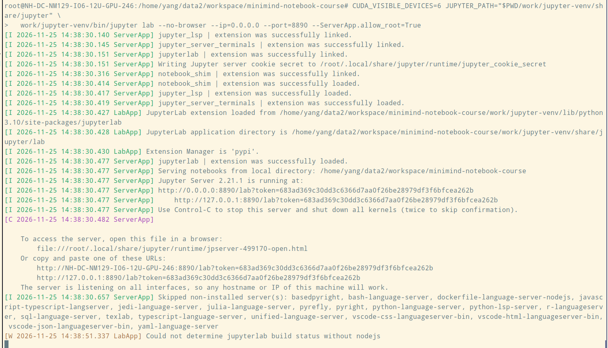
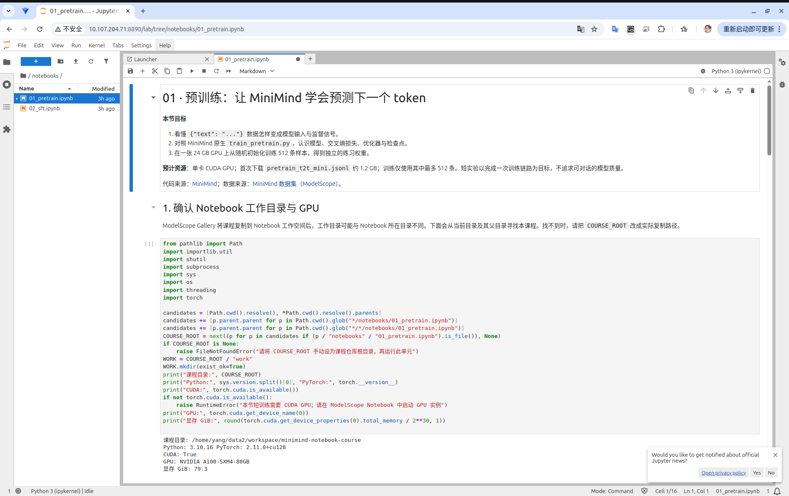

# MiniMind 实战课：单卡走通大模型训练

一套以 [MiniMind](https://github.com/jingyaogong/minimind) 为源码、以 Jupyter Notebook 为教材的动手课程。每节先解释阶段目标与关键代码，再给出单张 24 GB GPU 能运行的短实验。GitHub 保存课程源文件；计划在 ModelScope Gallery 阅读、在 ModelScope Notebook 运行同一份 Notebook。

## 课程目录

| 章节 | 内容 | Notebook |
| --- | --- | --- |
| 01 预训练 | next-token 目标、数据格式、训练循环、检查点；从零完成一次短训练 | [01_pretrain.ipynb](notebooks/01_pretrain.ipynb) |
| 02 指令微调 | 对话模板、助手标签掩码、从 Pretrain 权重继续训练 | [02_sft.ipynb](notebooks/02_sft.ipynb) |

第一节从 ModelScope 获取 `gongjy/minimind_dataset` 的 `pretrain_t2t_mini.jsonl`，截取最多 512 条样本做练习；第二节获取 `sft_t2t_mini.jsonl`，筛选 256 条短实验数据，并从第一节的权重继续训练。两个完整文件首次下载分别约 1.2 GB 和 1.7 GB；短实验只训练截取后的数据。课程运行产生的数据和权重保存在 `work/`，不进入 Git。

## 运行条件

- Linux、Python 3.10+，有 CUDA 支持的 PyTorch；推荐单张 24 GB GPU。
- ModelScope Notebook 或本地 Jupyter。
- 能访问 GitHub 获取 [MiniMind 源码](https://github.com/jingyaogong/minimind)，能访问 ModelScope 获取[数据集](https://modelscope.cn/datasets/gongjy/minimind_dataset)。
- Notebook 检查所需包；只按提示安装缺失项，不自动替换 CUDA/PyTorch。

先打开 `notebooks/01_pretrain.ipynb`，再打开 `notebooks/02_sft.ipynb`，各节按顺序运行。

## 在当前服务器逐格运行

在课程目录打开一个终端，启动课程专用 JupyterLab。命令中的 GPU 6 是服务器上的物理编号；只在这台多卡服务器上使用这个编号。

```bash
cd /home/yang/data2/workspace/minimind-notebook-course
CUDA_VISIBLE_DEVICES=6 JUPYTER_PATH="$PWD/work/jupyter-venv/share/jupyter" \
  work/jupyter-venv/bin/jupyter lab --no-browser --ip=0.0.0.0 --port=8890 --ServerApp.allow_root=True
```



在本地浏览器打开启动日志里的 `http://127.0.0.1:8890/lab?token=...`。

打开 `notebooks/01_pretrain.ipynb`，右上角选择 **MiniMind Course** 内核。



若想从头观察过程，选择 **Kernel → Restart Kernel and Clear All Outputs**，随后逐格按 `Shift+Enter`；完成后再打开 `02_sft.ipynb`。最后保存 Notebook。已有输出来自课程验证运行，可以先查看。

## 课程约定

1. 每节写明目标、输入、输出和可复现实验预算。
2. 学习者从 ModelScope 下载数据与模型资源；MiniMind 训练源码来自上游 GitHub。
3. 短实验用于理解流程，不代表完整训练效果。完整训练参数见 [MiniMind README](https://github.com/jingyaogong/minimind)。
4. 不提交数据集、模型权重与运行日志。
5. 本轮课程只覆盖 Pretrain 和 SFT；后续章节按需要另行规划。

## 来源与许可

模型代码来自 [jingyaogong/minimind](https://github.com/jingyaogong/minimind)，训练数据来自 [gongjy/minimind_dataset](https://modelscope.cn/datasets/gongjy/minimind_dataset)。本仓库是独立教学材料；复用或分发上游文件时应遵守各自的许可与署名要求。
